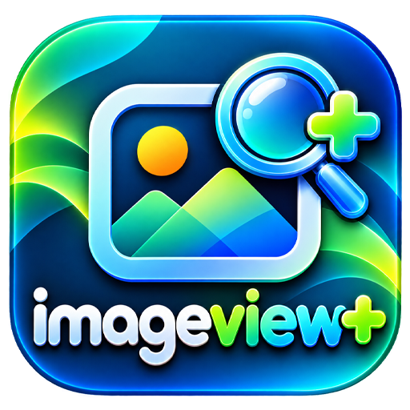

# ImageView+ v1.2

<p align="center">
  
</p>

**ImageView+**, Windows ve çapraz platformlar için geliştirilmiş ultra hızlı, modern arayüzlü (**Liquid Glass**, **Koyu**, **Açık** temalı) ve **40+ görüntü formatını** (özellikle **DNG / Kamera RAW** ve **WebP / AVIF / TGA / TIFF / PSD / HEIC**) anında açabilen masaüstü resim görüntüleyicisidir.

---

## ✨ Özellikler

- **⚡ Ultra Hızlı DNG & RAW Motoru (`< 6ms`):** DNG, CR2, NEF, ARW, ORF, RW2, PEF, RAF, SRW dosyalarındaki tam çözünürlüklü gömülü JPEG önizlemelerini ve SubIFD verilerini tüm dosyayı belleğe yüklemeden sadece başlık baytlarını okuyarak milisaniyeler içinde açar.
- **🖼️ 40+ Görüntü Formatı Desteği:**
  - **Standart & Modern Web:** `WEBP`, `JPG`, `JPEG`, `JFIF`, `PNG`, `APNG`, `GIF`, `BMP`, `DIB`, `SVG`, `SVGZ`, `ICO`, `CUR`, `AVIF`
  - **Kamera RAW:** `DNG`, `CR2`, `CR3`, `NEF`, `ARW`, `ORF`, `RW2`, `PEF`, `SRW`, `RAF`, `3FR`, `ERF`, `KDC`, `MEF`, `MRW`, `NRW`
  - **Profesyonel & Grafik:** `TIF`, `TIFF`, `TGA`, `ICB`, `VDA`, `VST`, `PSD`, `HEIC`, `HEIF`, `JP2`, `J2K`, `JXL`, `PPM`, `PGM`, `PNM`, `PCX`
- **🎨 3 Arayüz Teması & 7 Arka Fon Seçeneği:**
  - **Temalar (`U` tuşu):** *Liquid Glass (Şeffaf)*, *Koyu (Siyah)*, *Açık (Beyaz)*
  - **Arka Fonlar (`B` tuşu):** *Damalı (Varsayılan)*, *Açık Damalı*, *Liquid Glass Bulanık*, *Tam Siyah*, *Tam Beyaz*, *Stüdyo Grisi*, *Gece Mavisi*
- **🌍 10 Dil Desteği (Otomatik Windows Dil Algılama):**
  - Türkçe (`tr`), İngilizce (`en`), Almanca (`de`), Fransızca (`fr`), İspanyolca (`es`), Rusça (`ru`), Çince (`zh`), Japonca (`ja`), Arapça (`ar`), Portekizce (`pt`)
- **🖥️ Gerçek Tam Ekran (Borderless Fullscreen):** `F`, `F11` veya çift tıklama ile Windows görev çubuğu ve tüm çerçeveler gizlenerek gerçek tam ekran moduna geçer.
- **🔧 Ekstra Araçlar:**
  - EXIF & Kamera/Lens Metadata + RGB Histogram Paneli (`I`)
  - Otomatik Slayt Gösterisi (`S`)
  - Alt Film Şeridi (`T`), Döndürme (`R` / `L`), Aynalama (`H` / `V`), Kayıpsız Dışa Aktarma (`Ctrl+E`)
  - Tek tıkla veya kurulum sırasında tüm resim formatları için **Windows Varsayılan Görüntüleyici** olma

---

## 🚀 Kurulum & Çalıştırma

### Geliştirici Modu
```bash
npm install
npm start
```

### Windows Setup Kurulum Paketi (`ImageView+_Setup_1.2.0.exe`) Oluşturma
```bash
npm run setup
```

---

## 👨‍💻 Geliştirici & İletişim

- **Geliştirici:** Hakan GERMAN — **MARKA DESTEK**
- **Web:** [www.markadestek.com](https://www.markadestek.com)
- **Sürüm:** `v1.2.0`
